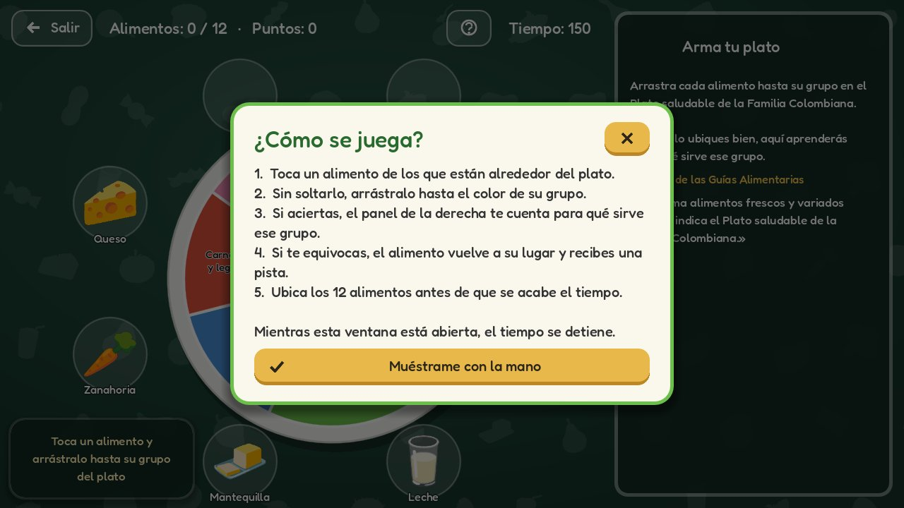
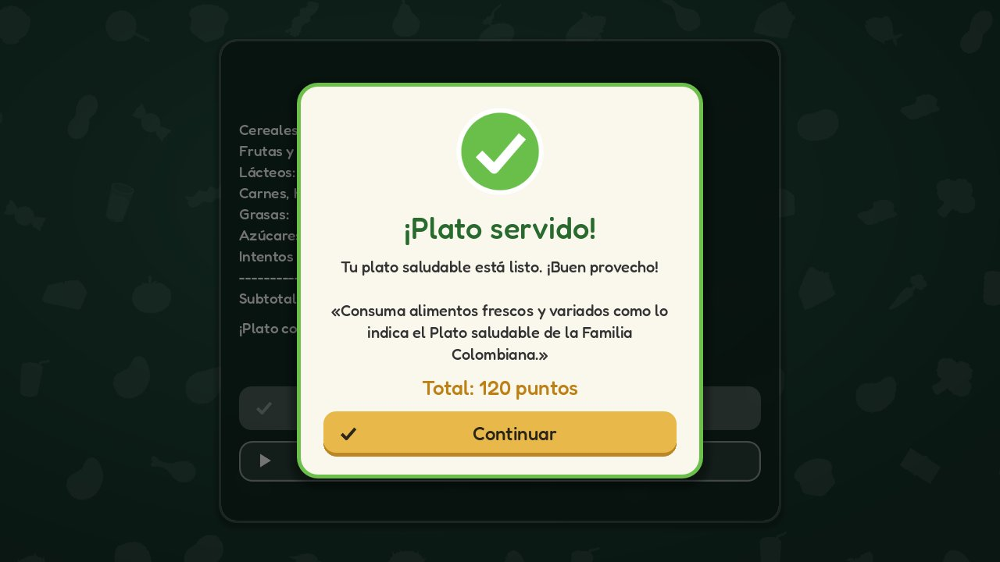

# Guía 8 · Evaluación y Mejora de la Experiencia de Usuario

**Etapa del proyecto:** `lab-8` · tag `lab-8-final`

## Qué pide la guía

1. Prueba de uso con una persona que no conoce el juego (test escrito + observaciones).
2. Analizar la comunicación del minijuego (*Pizza Rush*) con el formato Situación / Mejora / Resultado.
3. Convenciones de interfaz e íconos (identificarlos).
4. Theme `ui_theme.tres` en `src/assets/ui` con estados Normal / Hover / Pressed / Disabled, asignado en la raíz de cada escena de interfaz.
5. Fondo `TextureRect` en el menú (Ignore Size, Keep Aspect Centered, Z Index negativo, Mouse Filter Ignore). Menú terminado y decorado.
6. Popup de confirmación en la factura (`PurchaseSuccessPopup`) que se muestra al confirmar.
7. Retos: instrucciones progresivas, otra mejora detectada en pruebas, popup refinado.

## Cómo se aplicó a Mi Plato Saludable

| Guía (Pizza) | Proyecto (Plato) | Archivo |
|---|---|---|
| Prueba de uso | Test con el flujo plato → estrellas → plato con estrella | `doc/ux/prueba_de_usuario.md` |
| Análisis de *Pizza Rush* | Análisis del plato interactivo (tomar, arrastrar, soltar bien, soltar mal, ayuda, terminar) | `doc/ux/analisis_interacciones.md` |
| Iconografía | Tabla con las 5 preguntas para 12 botones; **además se implementaron** los íconos | `doc/ux/iconografia.md`, `src/assets/ui/icons/` |
| `ui_theme.tres` | Theme con estados de botón y variaciones `SecondaryButton`, `PopupCard`, `PopupOverlay`, `PopupTitle`, `PopupText`; interruptores verde/gris | `src/assets/ui/ui_theme.tres` |
| Fondo del menú | Ilustración propia: mantel de cuadros con alimentos + mascota **Nutri** que "respira" y da consejos GABA | `menu_panel.tscn`, `src/assets/ui/menu_background.png`, `mascot_nutri.png` |
| `PurchaseSuccessPopup` | `PlateSuccessPopup` en el resumen del plato | `plate_summary.tscn/.gd` |

### Theme (Paso 2.3)

* `Button`: `normal` amarillo algo apagado, `hover` más vivo con borde claro y sombra, `pressed` más oscuro con borde de 3 px, `disabled` gris plano, `focus` con contorno. Colores de texto e íconos por estado.
* `SecondaryButton` (Volver, Ajustes, Créditos, Salir): verde oscuro translúcido con texto blanco, para que la acción principal (amarilla) destaque.
* Asignado en la raíz de: `MainApp/SceneContainer`, `MenuPanel`, `ConfigPanel`, `CreditsPanel`, `AlbumPanel`, `BonusEvent`, `PlateSummary`, los controles de `PlateGame` (HUD, panel de información, resultado, ayuda; la raíz es un `Node2D`, que no tiene propiedad Theme) y los del minijuego.

### Fondo y menú (Paso 2.4)

`Background` (`TextureRect`): `expand_mode = Ignore Size`, `stretch_mode = Keep Aspect Centered`, `z_index = -1`, `mouse_filter = Ignore`. Para que se viera, los fondos de `MainApp` se bajaron a `z_index = -10`. El título va sobre una banda oscura para mantener el contraste.

### Popup (Parte 3)

```gdscript
@onready var pop_up_confirm: Panel = $PlateSuccessPopup

func _on_confirm() -> void:
	if not applied_bonus.is_empty():
		GlobalManager.remove_bonus(applied_bonus)   # se mantiene la lógica
	lbl_bonus.text = "¡Plato confirmado!"
	...
	_show_success_popup()                           # pop_up_confirm.show() + animación
```

El botón *Continuar* es un `ButtonNav` hacia el menú con `discard_previous`.

### Mejoras adicionales para que el juego sea más entretenido

* **Sonidos** (`AudioManager`, autoload): clic, tomar, soltar, acierto, error, racha, estrella, victoria y derrota. Opción para apagarlos.
* **Racha** de aciertos con banner y **confeti** al completar el plato.
* **Cursor** de mano y de arrastre sobre los alimentos.

## Verificación realizada

`tests/test_lab8.gd` (con mouse real en Xvfb): Theme en las escenas, fondo con z negativo y mouse ignore, íconos, sonido apagable y persistente, mano guía la primera vez, ayuda que pausa y reanuda el tiempo, tutorial completado al primer acierto, "+10" flotante, racha x3, error que reinicia la racha, popup oculto → visible con el total 120 → *Continuar* vuelve al menú. **0 fallas.** Regresión de las Guías 6 y 7 (arrastre, persistencia, minijuego): superada.

| Menú decorado | Mano guía e instrucción |
|---|---|
|  |  |
| **Ayuda (pausa el tiempo)** | **Popup de confirmación** |
|  |  |
